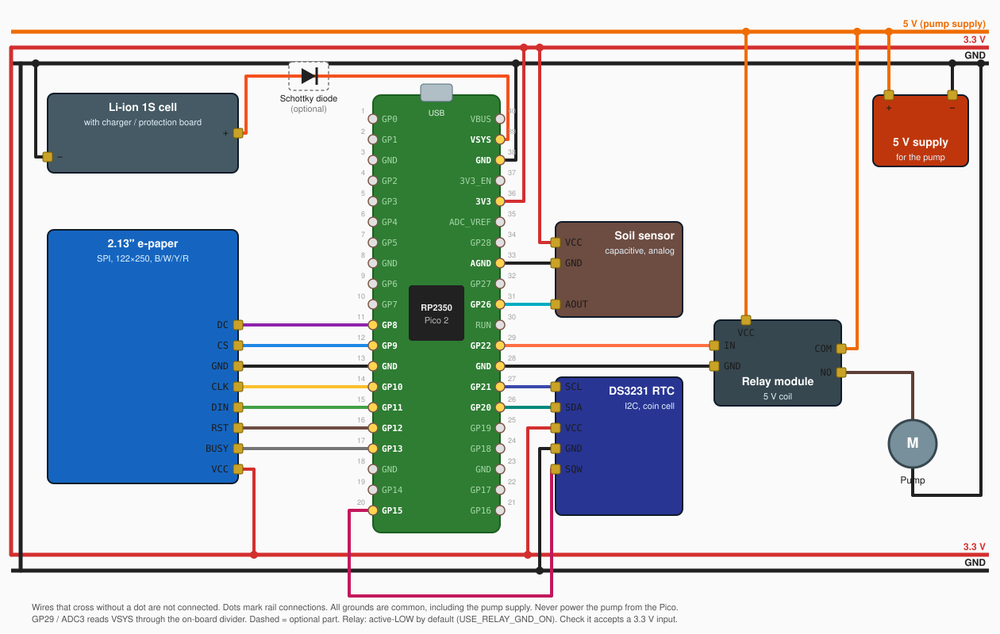

# pico-watering-system

Low-power automatic plant watering controller for the **Raspberry Pi Pico 2 (RP2350)**, written in C on the Pico SDK.

The board spends almost all its time powered off. A DS3231 RTC alarm wakes it at a configurable interval (hours and/or days). It then reads a capacitive soil-moisture sensor, runs the pump if the soil is too dry, refreshes a 2.13" 4-color e-paper dashboard, and powers itself off again. It runs from USB or a single Li-ion cell and shows the battery level.

## How it works

Every wake is a full reboot, so `main()` runs from the top once per wake:

1. **Pump off.** The pump pin is the first thing set up, latched to "off" before it becomes an output, so the relay never pulses at boot.
2. **RTC.** The RTC is set from the firmware compile time **only** if the DS3231 oscillator-stop flag is set (new module, dead coin cell) or the RTC is behind the compile time (first boot after flashing). If the RTC can't be read, the time is left alone.
3. **Next wake.** Alarm 1 is armed for the current hour (rounded down to `hh:00:00`) plus `WAKE_INTERVAL_DAYS` / `WAKE_INTERVAL_HOURS`, using a date + time match. If the RTC can't be read, it falls back to the next full hour, so the board never sleeps forever. Alarm 2 is not used and is disabled on the module.
4. **Measure.**
   - Soil: 16 samples on `ADC0 / GP26`, averaged and mapped to 0–100 % using `AIR_VALUE` and `WATER_VALUE`.
   - Supply: `VSYS` on `ADC3 / GP29` (the Pico 2's on-board 1/3 divider), read before the pump starts.
   - Temperature: the RP2350's on-chip sensor (chip temperature, not true room temperature).
5. **Decide.** Core 0 decides once: water if the reading is valid and moisture is below `MIN_HUMIDITY`. It sends the pump run time (`TIME_POMP_ON` ms, or 0) to core 1 through the multicore FIFO.
6. **Water + display.** Core 1 runs the pump while core 0 draws and refreshes the e-paper.
7. **Sleep.** Core 0 clears the alarm flag (releasing the `INT/SQW` wake line), waits for the pump to finish, and enters the `powman` power-off state. The low level on `GP15` at the next alarm wakes it.

### When the pump does *not* run

- **Moist enough.** Moisture is at or above `MIN_HUMIDITY`. The display shows `OPTIMAL`.
- **Sensor fault.** The averaged reading is below `SENSOR_MIN_RAW` (shorted or disconnected), or the 16 samples spread by more than `SENSOR_MAX_SPREAD` (floating wire). The display shows `SENSOR ERR` and `--%`.

## Display


The static background (cards, icons, moisture bar frame) is an image in the driver: `lib/pico-epd-driver/src/canvas/images/watering_template.h`. All text is drawn by the firmware on top of it, in one font family (the driver's Tahoma bitmap font) in three sizes:

| Area | Content |
| --- | --- |
| Header | `HEADER_TITLE_TEXT`, battery icon with 0–3 bars, battery voltage or `USB` |
| Plant | `PLANT_NAME_TEXT` (medium), `PLANT_SUB_TEXT` (small, red) |
| Soil moisture | Moisture % (large), raw ADC value (small, right), status, filled bar (red below `MIN_HUMIDITY`, yellow above), DRY / OK / WET scale |
| Temperature | Chip temperature, e.g. `21.1°C` |
| Last refresh | Date and time of this wake (`MM-DD HH:MM`), wake interval (`Cycle: 1h`, `Cycle: 1d 12h`) |

The status describes what this wake **did**, so it stays correct until the next refresh:

| Status | Meaning |
| --- | --- |
| `WATERED 5s` (red) | The pump ran for `TIME_POMP_ON` |
| `OPTIMAL` | No watering needed |
| `SENSOR ERR` (red) | Invalid sensor reading, pump not run |

The moisture % and bar show the reading taken **before** watering. The raw value (averaged ADC reading, 0–4095) is shown in every state, including `SENSOR ERR`, so you can calibrate `AIR_VALUE` / `WATER_VALUE` and diagnose sensor faults without `DEBUG`.

### Battery (single Li-ion cell on VSYS)

| VSYS | Bars | Approx. charge |
| --- | --- | --- |
| ≥ 4.40 V | 3, text `USB` | On USB / 5 V |
| ≥ 3.95 V | 3 | 70–100 % |
| ≥ 3.75 V | 2 | 40–70 % |
| ≥ 3.55 V | 1 (red bar and text) | 10–40 % |
| < 3.55 V | 0 (red text) | Charge now |

If the cell feeds VSYS through a Schottky diode, VSYS reads 0.2–0.3 V below the cell voltage; lower the thresholds accordingly. The reading uses the 3.3 V rail as reference (about ±2–3 %).

## Hardware

| Part | Notes |
| --- | --- |
| Raspberry Pi Pico 2 | `PICO_BOARD pico2` |
| DS3231 RTC module | I2C0, with a backup coin cell |
| 2.13" SPI e-paper, 122×250, black/white/yellow/red | Driver: [pico-epd-driver](https://github.com/shatterbind/pico-epd-driver) |
| Capacitive soil-moisture sensor | Analog output |
| Relay module or MOSFET + flyback diode | Drives the pump |
| Small DC pump + external supply | Never power the pump from the Pico |
| Optional: single-cell Li-ion battery | On VSYS, with a charger/protection board |
| Optional: Schottky diode (e.g. 1N5817, SS14) | Between the battery and VSYS, see below |

## Pinout

| Signal | Pico pin |
| --- | --- |
| Soil sensor AOUT | GP26 (ADC0) |
| Supply voltage | GP29 (ADC3, on-board VSYS/3 divider, no wiring needed) |
| Pump relay IN | GP22 |
| DS3231 SDA | GP20 (I2C0 SDA) |
| DS3231 SCL | GP21 (I2C0 SCL) |
| DS3231 INT/SQW (wake) | GP15 |
| EPD DC | GP8 |
| EPD CS | GP9 |
| EPD CLK | GP10 |
| EPD MOSI (DIN) | GP11 |
| EPD RST | GP12 |
| EPD BUSY | GP13 |

All grounds, including the pump supply's ground, must be common.

### Wiring diagram



Pin numbers are the Pico 2's physical pins (USB at the top). 3.3 V comes from the Pico's `3V3` pin (36); the relay coil and the pump run from a separate 5 V supply whose ground joins the common GND. Dashed parts are optional. The diagram is generated by `node docs/gen-wiring.cjs`; edit that script when the wiring changes.

**Schottky diode (optional).** The Pico already has a diode from VBUS (USB) to VSYS. Add a second one from the battery to VSYS when USB and the battery can be connected at the same time: then whichever supply is higher powers the board, and USB can't push current back into the battery outside its charger. You can leave it out when the board runs only from the battery, or when your charger board has a load-sharing / power-path output. With the diode, VSYS reads about 0.2–0.3 V below the cell voltage (see Battery above).

## Configuration (`main.c`)

### Watering and sensor

| Define | Default | Meaning |
| --- | --- | --- |
| `AIR_VALUE` / `WATER_VALUE` | `4095` / `1100` | Raw ADC readings with the sensor in dry air and in water. Calibrate for your sensor (see `DEBUG`). |
| `MIN_HUMIDITY` | `40` % | Water when moisture is below this value. |
| `TIME_POMP_ON` | `5000` ms | How long the pump runs per wake. |
| `SENSOR_SAMPLES` | `16` | ADC samples averaged per reading. |
| `SENSOR_MIN_RAW` / `SENSOR_MAX_SPREAD` | `300` / `300` | Sensor fault thresholds (see above). Raise `SENSOR_MAX_SPREAD` if a working sensor shows `SENSOR ERR`. |
| `POMP_PIN` | `22` | Relay control pin. |
| `USE_RELAY_GND_ON` | `true` | `true`: the relay is active-LOW. `false`: active-HIGH. |

### Schedule and RTC

| Define | Default | Meaning |
| --- | --- | --- |
| `WAKE_INTERVAL_DAYS` / `WAKE_INTERVAL_HOURS` | `0` / `1` | Time between wakes. Wakes always land on a full hour. Must be 1 hour to 27 days (checked at compile time). |
| `CONFIGURE_RTC` | `1` | Sets the RTC from compile time when it has lost time or is behind (see above). |
| `COMPILE_UPLOAD_OFFSET_SECONDS` | `6` | Added to the compile time to cover the time between compiling and the board booting. |
| `DEBUG` | off | Uncomment to loop forever and print RTC time, raw soil value, spread, % and VSYS over USB/UART once per second. Use this to calibrate. |

### Battery

| Define | Default | Meaning |
| --- | --- | --- |
| `VSYS_USB_V` | `4.40` V | Above this, the board is on USB and shows `USB`. |
| `BATTERY_3_BARS_V` / `BATTERY_2_BARS_V` / `BATTERY_1_BAR_V` | `3.95` / `3.75` / `3.55` V | Li-ion bar thresholds. |

### Display text

| Define | Default | Meaning |
| --- | --- | --- |
| `HEADER_TITLE_TEXT` | `"shatterbind"` | Top-left title, max ~58 px (a serial warning is printed if it's too wide). |
| `PLANT_NAME_TEXT` / `PLANT_SUB_TEXT` | `"Indian"` / `"Laurel"` | Plant card. |
| `STATUS_WATERED_FORMAT` / `STATUS_OPTIMAL_TEXT` / `STATUS_SENSOR_ERROR_TEXT` | `"WATERED %us"` / `"OPTIMAL"` / `"SENSOR ERR"` | Moisture status, max 73 px wide. |
| `MOISTURE_RAW_LABEL_TEXT` | `"raw"` | Label above the raw ADC value (right column of the moisture card, 23 px wide). |
| `FOOTER_CYCLE_FORMAT` | `"Cycle: %s"` | Footer interval text; `%s` becomes e.g. `1h`, `2d`, `1d 12h`. |
| `FONT_SMALL` / `FONT_MEDIUM` / `FONT_LARGE` | Tahoma 8 / 12 / 16 | The three text sizes. Each font must be enabled in `CMakeLists.txt` (`USE_FONT_TAHOMA_*`). |

Positions are the `SLOT_*` and `LABEL_*` defines next to these. Text widths: Tahoma 8 capitals are 8 px high, Tahoma 16 capitals 16 px.

## Calibration

1. Uncomment `#define DEBUG`, build and flash, and open the USB serial port.
2. Hold the sensor in dry air: note `Raw humidity sensor value` → `AIR_VALUE`.
3. Put it in water up to its line: note the value → `WATER_VALUE`.
4. Check the `spread` stays well below `SENSOR_MAX_SPREAD` with the sensor connected.
5. Compare `VSYS` with a multimeter on the battery.
6. Comment `DEBUG` out again and rebuild.

## Building

The project uses the Raspberry Pi Pico VS Code extension's toolchain, pinned in `CMakeLists.txt` (SDK 2.2.0, ARM GCC 14.2, picotool 2.2.0-a4). Open the folder in VS Code with the extension installed and it downloads them into `~/.pico-sdk`.

```sh
git clone --recurse-submodules https://github.com/shatterbind/pico-watering-system
# or, in an existing clone:
git submodule update --init

cmake -S . -B build -G Ninja
cmake --build build
```

On Windows outside VS Code, put the extension's tools on `PATH` first, e.g. `~/.pico-sdk/cmake/<version>/bin` and `~/.pico-sdk/ninja/<version>`.

Flash `build/pico_watering_system.uf2` by holding BOOTSEL while plugging the board in and copying the file to the drive, or run `picotool load -x build/pico_watering_system.uf2`.

## Libraries (git submodules)

| Path | Library |
| --- | --- |
| `lib/pico-ds3231` | DS3231 RTC driver on I2C0. Every I2C call has a timeout. |
| `lib/pico-epd-driver` | 2.13" e-paper driver, canvas, fonts and the dashboard template. |

```sh
# Check out the exact commits this repo pins (after a clone or pull):
git submodule update --init --recursive

# Pull the latest upstream commits of the libraries:
git submodule update --remote --merge

# Record the new library versions in this repo:
git add lib
git commit -m "update modules"
```

Check what changed with `git submodule status` or `git diff --submodule`.

When you change a library (for example the template), commit and **push it inside the submodule first**, then commit the new pointer here. Otherwise a fresh clone points to a commit that doesn't exist on GitHub.

### Changing the dashboard background

`lib/pico-epd-driver/scripts/generate_watering_template.py` (Python 3 + Pillow) draws the template and a preview with sample values. It writes `assets/watering_template.png`, `assets/watering_preview.png` and `src/canvas/images/watering_template.h` (2 bits per pixel: black, white, yellow, red). Card positions in the script must match the `SLOT_*` / `LABEL_*` defines in `main.c`.

## Known limitations

- There is no minimum time between pump runs; the wake interval is the only limit.
- The moisture % on screen is the reading from before watering.
- The RTC doesn't follow daylight-saving changes. To reset it, remove the coin cell briefly (sets the oscillator-stop flag) and flash again.
- The temperature is the RP2350 chip temperature. It reads a few degrees above room temperature right after boot.
- No tests: hardware behavior can only be checked on the device.

## Safety

- Use a relay or MOSFET with a flyback diode for the pump, and supply the pump separately.
- Check that your relay module accepts a 3.3 V logic input.
- Test with the pump out of the water first, and keep the electronics away from water.

## License

MIT. See [LICENSE](LICENSE).
